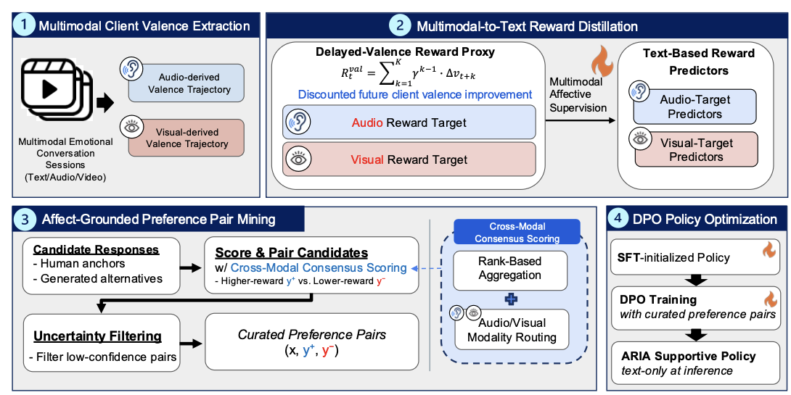

# ARIA-ESC

[](https://aclanthology.org/2026.findings-emnlp.814/)
[](https://www.python.org/downloads/)

This repository contains the reference implementation of **ARIA** (Affect-Responsive Interaction Alignment), which aligns emotional-support policies with implicit multimodal affective feedback from help-seekers.

## 📄 Paper Information

**Title:** [ARIA: Affect-Responsive Interaction Alignment for Emotional Support Policies via Implicit Multimodal Affective Feedback](https://aclanthology.org/2026.findings-emnlp.814/)

**Authors:** Deuksin Kwon, Kevin Hyekang Joo, Elena Hayoung Lee, Mohammad Soleymani, Gale M. Lucas

**Conference:** Findings of EMNLP 2026

<div align="center">

</div>

## 🎯 Components

- **Delayed-Valence Targets**: Discounted delayed-valence targets from client valence trajectories
- **Valence Predictors**: Calibrated delayed-valence predictors
- **Preference Mining**: Affect-grounded preference pairs from human references and sampled candidates
- **Policy Training**: LoRA SFT and DPO
- **Multi-turn Rollout**: Support-provider and simulated help-seeker dialogues
- **LLM-as-Judge Evaluation**: The seven main-paper metrics

For any questions, please contact: **Brian Deuksin Kwon** (deuksink@usc.edu)

---

## 🚀 Quick Start

### 1. Environment Setup

```bash
git clone https://github.com/DSincerity/ARIA-ESC.git
cd ARIA-ESC

python3 -m venv .venv
source .venv/bin/activate
pip install -e .
```

### 2. Serve the Seeker and Judges with vLLM

The simulated help-seeker and the three judges use Qwen2.5-32B-Instruct through an OpenAI-compatible endpoint. Install vLLM in a separate environment, since its dependencies can conflict with the pinned training packages, and start a server:

```bash
python -m venv .venv-vllm && source .venv-vllm/bin/activate
pip install vllm
vllm serve Qwen/Qwen2.5-32B-Instruct --port 8000
```

Point the seeker (rollout) and the judges (evaluation) to this endpoint:

```bash
bash scripts/simulation/run_rollout.sh --seeker-model Qwen/Qwen2.5-32B-Instruct \
  --seeker-base-url http://localhost:8000/v1 ...
bash scripts/evaluate/run_evaluation.sh --model Qwen/Qwen2.5-32B-Instruct \
  --base-url http://localhost:8000/v1 ...
```

### 3. API Keys (Optional)

API keys are needed only when an API model is used as the support provider (e.g., GPT-4.1 mini) or as the LLM admissibility reviewer. The reviewer uses an OpenAI-compatible endpoint; an Anthropic key is used only for an Anthropic support provider.

```bash
export OPENAI_API_KEY="your-openai-api-key"
export ANTHROPIC_API_KEY="your-anthropic-api-key"  # Anthropic support provider only
```

### 4. Verify Installation

```bash
bash scripts/simulation/run_rollout.sh --help
```

## 🧪 Pipeline

| Step | Script |
|------|--------|
| 1. Build delayed-valence targets | `scripts/process_data/build_delayed_targets.sh` |
| 2. Train valence predictors | `scripts/train/train_valence_predictor.sh` |
| 3. Train the SFT policy | `scripts/train/train_sft.sh` |
| 4. Screen human references | `scripts/process_data/prepare_human_anchors.sh` |
| 5. Sample and score candidates | `scripts/process_data/score_candidates.sh` |
| 6. Mine preference pairs | `scripts/process_data/mine_preferences.sh` |
| 7. Train with DPO | `scripts/train/train_dpo.sh` |
| 8. Run multi-turn rollouts | `scripts/simulation/run_rollout.sh` |
| 9. Evaluate | `scripts/evaluate/run_evaluation.sh` |

Each script accepts `--help`. Input records are JSONL; `examples/` contains format-only records for the predictor, SFT, DPO, and rollout inputs; other formats are documented in each module's docstring.

## 🏗️ Project Architecture

```
ARIA-ESC/
├── examples/                 # Format-only input records
├── images/                   # Figures
├── prompts/                  # Support-provider, seeker, judge, and admissibility prompts
├── scenarios/                # 25 rollout scenarios
├── scripts/                  # Entry points for each pipeline step
└── src/aria_esc/
    ├── agents.py             # Support-provider, seeker, and judge agents
    ├── backends.py           # OpenAI-compatible, Anthropic, and local checkpoint backends
    ├── process_data/         # Targets, human-reference screening, candidate scoring, preference mining
    ├── train/                # Valence predictor, calibration, SFT, DPO
    ├── simulation/           # Provider-seeker rollout
    ├── evaluation/           # Judges and metric aggregation
    └── utils/                # I/O and chat helpers
```

## 📚 Data

This work uses MESC; obtain it from the [original MESC repository](https://github.com/chuyq/MESC) under its terms.

## 📄 Citation

If you use this code in your research, please cite our paper:

```bibtex
@inproceedings{kwon-etal-2026-aria,
    title = "{ARIA}: Affect-Responsive Interaction Alignment for Emotional Support Policies via Implicit Multimodal Affective Feedback",
    author = "Kwon, Deuksin  and
      Joo, Kevin  and
      Lee, Elena Hayoung  and
      Soleymani, Mohammad  and
      Lucas, Gale M.",
    editor = "Lee, Hung-Yi  and
      Dev, Sunipa  and
      Li, Jessy  and
      Elliott, Desmond",
    booktitle = "Findings of the {A}ssociation for {C}omputational {L}inguistics: {EMNLP} 2026",
    month = oct,
    year = "2026",
    address = "Budapest, Hungary",
    publisher = "Association for Computational Linguistics",
    url = "https://aclanthology.org/2026.findings-emnlp.814/",
    pages = "17226--17249",
    ISBN = "979-8-89176-462-0"
}
```

## 📜 License

Please refer to the LICENSE file in the root directory for more details.
